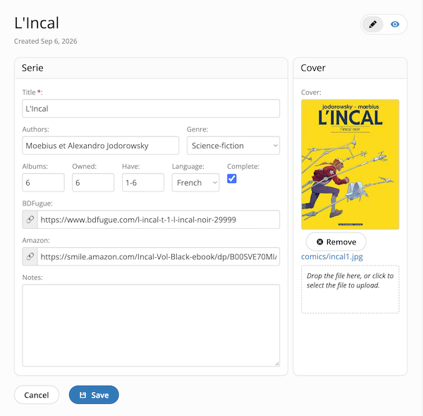
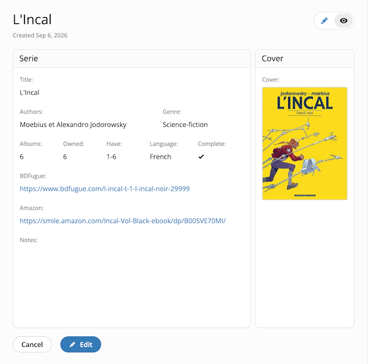
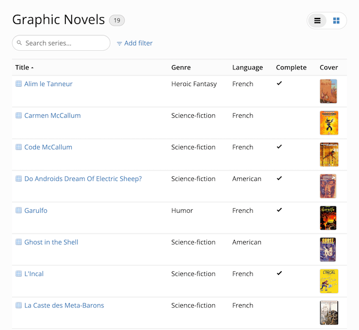
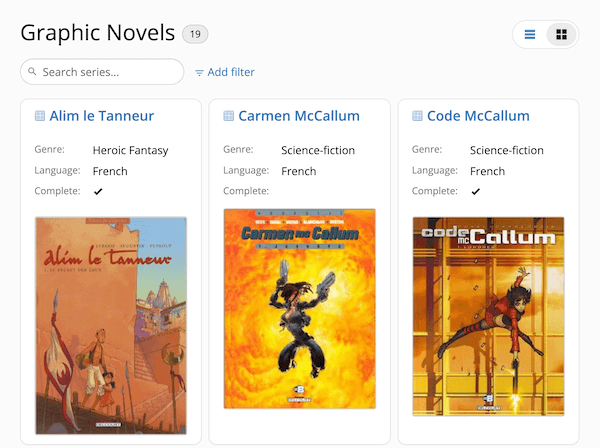
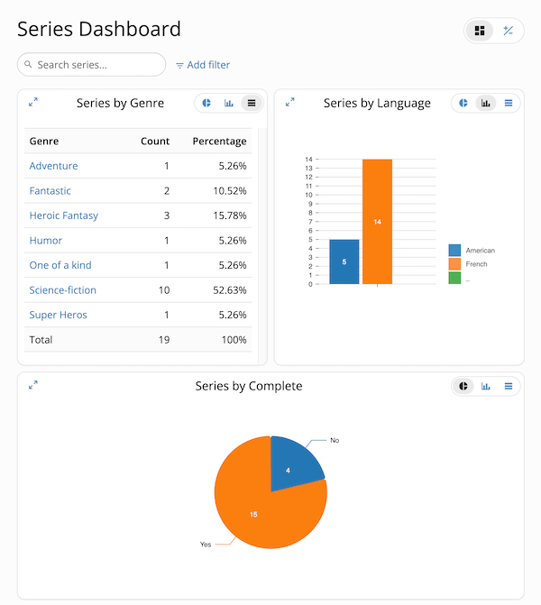
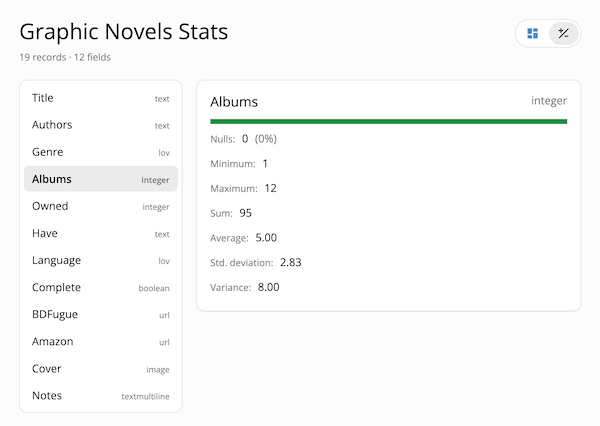
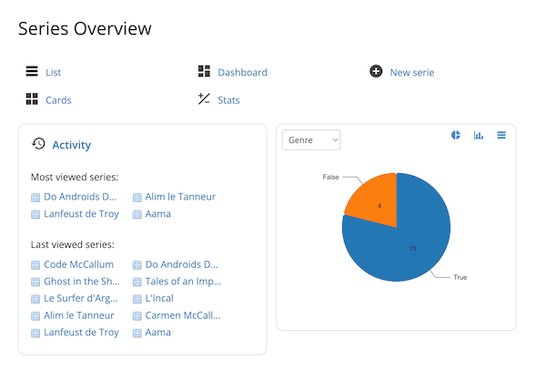
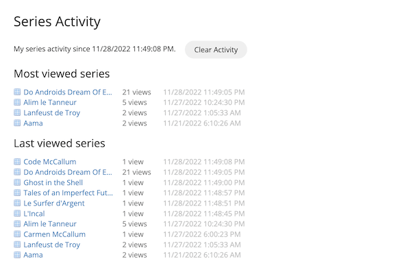

# Evolutility-UI-React &middot; [](https://github.com/evoluteur/evolutility-ui-react/blob/main/LICENSE) [](https://www.npmjs.com/package/evolutility-ui-react)


Evolutility-UI-React is a set of **model-driven views** to [Browse](#Browse), [Edit](#Edit), [List](#List), [Cards](#Cards), [Charts](#Charts), [Stats](#Stats), [Overview](#Overview), and [Activity](#Activity).

With it you can easily build CRUD applications by writing models rather than code. It uses the REST API of [Evolutility-Server-Node](https://github.com/evoluteur/evolutility-server-node). No hand-coding is necessary!

Check out the [live demos](https://evoluteur.github.io/evodemo/#/demos).




### Table of Contents
1. [Installation](#Installation)
2. [Configuration](#Configuration)
3. [Views](#Views) for [One](#ViewsOne), [Many](#ViewsMany) records, and for [Comfort](#ViewsComfort)
4. [Models](#Models)
5. [Designer](#Designer)
6. [Login](#Login)
7. [Backend](#Backend)
8. [License](#License)

<a name="Installation"></a>
## Installation

[**Download**](https://github.com/evoluteur/evolutility-ui-react/archive/master.zip) or **clone** from [GitHub](https://github.com/evoluteur/evolutility-ui-react/).

```bash
# To get the latest stable version, use git from the command line.
git clone https://github.com/evoluteur/evolutility-ui-react
```

or use the [npm package](https://www.npmjs.com/package/evolutility-ui-react):

```bash
# To get the latest stable version, use npm from the command line.
npm install evolutility-ui-react
```


In the Evolutility-UI-React directory, use the command line to type the following:

```bash
# Install dependencies
npm install

# Run the node.js server
npm start

```

In a web browser, go to the url [http://localhost:5173/](http://localhost:5173/).

For the REST endpoints, you also need to install and run [Evolutility-Server-Node](https://github.com/evoluteur/evolutility-server-node) which provides the matching REST endpoints based on the same metadata (see [Backend](#Backend)). The UI gets its models from the server when it starts.


<a name="Configuration"></a>
## Configuration

Configurations options are specified in the file [/src/config.ts](https://github.com/evoluteur/evolutility-ui-react/blob/main/src/config.ts). They apply to all apps (app specific options are specified in models).

| Option     | Description      | Example             |
|------------|------------------|---------------------|
| apiPath    | Path to the REST API. | "http://localhost:2000/api/v1/" |
| entityRoot | View shown at the object root url (ex: "/demos/todo/"): "list" (default) redirects to the List view, "overview" shows the Overview page. The Overview icon in the top bar is only shown with "overview". | "list" |
| useCache   | Enable/disable data caching (TanStack Query staleTime). | true |
| cacheDuration | Cache duration in seconds. | 120 (for 2 minutes) |
| filesUrl   | Path to upload files to. | "/pix/" |
| pageSize   | Page size in pagination.  | 50 |
| withActivity | Tracks and shows records activity (last visited and most visited). Currently implemented w/ the browser's localStorage, it will be moved to the server later. | true |
| withTimestamp | Tracks and shows timestamp for creation date and last update for every record. The DB tables need timestamp columns "updated_at" and "created_at" for the feature to work. (partial implementation) | true |
| withWhoIs | Shows who created and last updated records ("Updated 2 days ago by Ada"). Needs the option "wWhoIs" on the server. | true |

Light and dark modes: the UI follows the OS setting by default, and the sun/moon button in the top bar switches between them (the choice is saved in the browser's localStorage).


<a name="Views"></a>
## Views

For any object, a single model defines UI elements across views in a simple declarative way.

Evolutility-UI-React provides different types of view:

* Views for One - a single record: [Browse](#Browse), [Edit](#Edit).
* Views for Many - a collection of records: [List](#List), [Cards](#Cards), [Charts](#Charts), [Stats](#Stats).

Evolutility calls the REST API of [Evolutility-Server-Node](https://github.com/evoluteur/evolutility-server-node) with [TanStack Query](https://tanstack.com/query).

Notes: Views for actions (search, filter, export) will come later.


<a name="ViewsOne"></a>
## Views for One object

[Browse](#Browse) - [Edit](#Edit)

<a name="Browse"></a>
### Browse
Shows all fields for viewing (read only). Fields are grouped in panels.



Code: [/src/components/views/one/Browse/Browse.tsx](https://github.com/evoluteur/evolutility-ui-react/blob/main/src/components/views/one/Browse/Browse.tsx)

Route: "/{entity}/browse/{id}"

<a name="Edit"></a>
### Edit
This view shows all fields for edition to create or update records.
It automatically performs validation based on the model.
Fields are grouped in panels and tabs.


Code: [/src/components/views/one/Edit/Edit.tsx](https://github.com/evoluteur/evolutility-ui-react/blob/main/src/components/views/one/Edit/Edit.tsx)

Route: "/{entity}/edit/{id}"


<a name="ViewsMany"></a>
## Views for Many objects

[List](#List) - [Cards](#Cards) - [Charts](#Charts) - [Stats](#Stats)

<a name="List"></a>
### List
Gives a tabular view of a collection.



Code: [/src/components/views/many/List/List.tsx](https://github.com/evoluteur/evolutility-ui-react/blob/main/src/components/views/many/List/List.tsx)

Route: "/{entity}/list" (and "/{entity}/" which redirects to it by default, see config option "entityRoot")

<a name="Cards"></a>
### Cards
Shows records side by side as cards.



Code: [/src/components/views/many/Cards/Cards.tsx](https://github.com/evoluteur/evolutility-ui-react/blob/main/src/components/views/many/Cards/Cards.tsx)

Route: "/{entity}/cards"

<a name="Charts"></a>
### Charts
Draws charts about the collection. Currently bars and pie charts are implemented, a list with count and percentages is also available. Only provided for fields of types like boolean, lov, integer, decimal, date... (not text or textmultilines).



Code: [/src/components/views/analytics/Charts/Charts.tsx](https://github.com/evoluteur/evolutility-ui-react/blob/main/src/components/views/analytics/Charts/Charts.tsx)

Route: "/{entity}/charts"

<a name="Stats"></a>
### Stats
Display last update, number of updates in the last week, the number of nulls for each field, and for numeric fields the min, max, count, average, or for string fields the min and max length.



Code: [/src/components/views/analytics/Stats/Stats.tsx](https://github.com/evoluteur/evolutility-ui-react/blob/main/src/components/views/analytics/Stats/Stats.tsx)

Route: "/{entity}/stats"


<a name="ViewsComfort"></a>
## "Comfort" views
Display a summary of the object and the latest activity on it.

<a name="Overview"></a>
### Overview
Display a summary of the object and the latest activity on it.



Code: [/src/components/views/comfort/Overview/Overview.tsx](https://github.com/evoluteur/evolutility-ui-react/blob/main/src/components/views/comfort/Overview/Overview.tsx)

Route: "/{entity}/overview" (and "/{entity}/" when the config option "entityRoot" is "overview")

<a name="Activity"></a>
### Activity
Show list of "last visited" and "most visited" records for the object (stored in the browser's localStorage).



Code: [/src/components/views/comfort/Activity/Activity.tsx](https://github.com/evoluteur/evolutility-ui-react/blob/main/src/components/views/comfort/Activity/Activity.tsx)

Route: "/{entity}/activity"


<a name="Models"></a>
## Models

Each model describe an object and its list of fields. A single model is used for all views (Browse, Edit, List, Cards...).

For any object, all UI views (List, Cards, Edit, Charts...) share the same model.
All Fields are present in the Edit and Browse views. Fields can be flagged with "inMany" to be included in the List and Cards views, or "noCharts" and "noStats" to be excluded from the Charts or Stats views.

Models are stored in the database of [Evolutility-Server-Node](https://github.com/evoluteur/evolutility-server-node) (as JSON) and the UI gets them from the server when it starts. They are written in [Evolutility-Models](https://github.com/evoluteur/evolutility-models) and can be edited in the app with the [Designer](#Designer). Only models flagged as "active" are listed in the menus.


### Object

| Property     | Meaning                                 |
|--------------|-----------------------------------------|
| id           | Unique key to identify the entity (used in route and as API parameter). |
| icon         | Icon file name for the entity (example: "cube.gif"). |
| name         | Object name (singular).    |
| namePlural   | Object name (plural).      |
| title        | Application name.          |
| fields       | Array of [Fields](#Field). |
| groups       | Array of [Groups](#Group). If not provided a single group will be used.   |
| collections  | Array of [Collections](#Collection).      |
| titleField      | Id of the field which value is used as record title. titleField can also be a function.                       |
| titleFunction  | Template to calculate the record title from its data. Example: "{firstname} {lastname}". For fields of type "lov", use "{fieldid.name}" for the label of the value (ex: "{wine.name} {drink_date}").       | X   | X   |
| defaultViewOne | To have List and Cards link to Edit instead of Browse, set defaultViewOne="edit". |


<a name="Field"></a>
### Field

Objects have fields.

| Property     | Meaning                               |
|--------------|---------------------------------------|
| id           | Unique key for the field (can be the same as column but doesn't have to be). |
| type         | Field type to show in the UI. Possible field types: <ul><li>boolean (yes/no)</li><li>date</li><li>decimal</li><li>document</li><li>email</li><li>image</li><li>integer</li><li>json</li><li>lov (list of values)</li><li>money</li><li>text</li><li>textmultiline</li><li>time</li><li>url</li></ul> |
| label        | Field description (displayed with an asterisk for required fields).      |
| labelShort   | Optional shorter version of the labels (used in List and Cards views). |
| required     | Determines if the field is required for saving.      |
| readOnly     | If set to true, the field value cannot be changed.   |
| defaultValue | Default field value for new records.    |
| format       | Field format (using moment for date values and numeral for  numeric values). |
| max, min     | Maximum/Minimum value allowed (only applies to numeric fields).      |
| maxLength, minLength | Maximum/Minimum length allowed (only applies to text fields).      |
| regExp       | Regular expression used to validate the field value.     |
| list         | List of  items in the dropdown as an array  of id-text objects (only for fields of "lov" type). If ommited, the list will be  retrieved in the first query by id on that object.   |
| lovIcon      | Set to True to include icon with LOV items(only for fields of "lov" type).    |
| object       | Model id for the object to link to (only for fields of "lov" type).     |
| chartObject | Optional overide for object name in charts (only for "lov" fields). |
| aggregate | Optional overide for aggregation name in charts (only for "lov" fields). |
| inMany       | Determines if the field is present (by default) in lists of records. |
| inSearch     | Determine if the field is used in text searches.  |
| height       | For fields of type "textmultiline", number of lines used in the field (in Browse and Edit views). |
| width        | Field width in Browse and Edit views (in percent of parent width). |
| help         | Optional help on the field. |
| chartType    | Default charts type used for the field ("Bars", "Pie", or "Table"). "Bars" is used if not specified. |
| noCharts     | Exclude field from charts (only applies to fields of type integer, decimal, money, boolean, list of values which are "chartable"). |
| noStats      | Exclude field from Stats.   |

<a name="Group"></a>
### Field Group

Field Groups are used to separate Fields into panels in the Edit and Browse views.

| Property     | Meaning                               |
|--------------|---------------------------------------|
| id           | Unique key for the group. It is optional.            |
| type         | Type of fields group. Only "panel" is currently supported (tab and other types of groups will be added later). |
| label        | Group title displayed in the group header.      |
| fields       | Array of field ids.       |
| width        | Width (in % of the container total width).        |
| help         | Optional help tooltip text.|
| header       | Optional text displayed at the top of the group (just below the group title).|
| footer       | Optional text displayed below the group.    |

Notes:
- Field Groups are optional. By default a single group holds all fields.
- Field Groups are positioned based on their "width" property the same way than fields are positioned inside groups.

<a name="Collection"></a>
### Collection

Multiple details tables can be specified with "collections".

| Property     | Meaning                               |
|--------------|---------------------------------------|
| id           | Unique key for the collection.        |
| title        | Collection title.                     |
| object       | Model.id for the Object to link to.   |
| fields       | Array of fields (objects or ids). Fields in collections can be field objects or just ids of fields in the collection's object.   |
| readOnly     | Specify if the collection is readOnly.   |
| hideIfEmpty  | Hide Collection when it is empty in Edit view (always hidden when empty in Browse view).  |
| help         | Optional help tooltip text.|
| header       | Text to be displayed before the collection.   |
| footer       | Text to be displayed below the collection.    |

Sample model using collections: [Wine Cellar](https://github.com/evoluteur/evolutility-models/blob/main/models/organizer/winecellar.ts).

### Sample model

The following example is the model for a simple graphic novels inventory app.

```javascript
{
    id: "comics",
    title: "Graphic Novels",
    name: "graphic novel serie",
    namePlural: "graphic novel series",
    icon: "comics.png",
    titleField: "title",
    fields:[
      {
          id: "title", type: "text",
          label: "Title",
          required: true, maxLength: 255,
          width: 100, inMany: true,
      },
      {
          id: "authors", type: "text",
          label: "Authors",
          inMany: true, width: 62,

      },
      {
          id: "genre", type: "lov",
          label: "Genre",
          width: 38, inMany: true,
          list: [
            {id: 1, text: "Adventure"},
            {id: 2, text: "Fairy tale"},
            {id: 3, text: "Erotic"},
            {id: 4, text: "Fantastic"},
            {id: 5, text: "Heroic Fantasy"},
            {id: 6, text: "Historic"},
            {id: 7, text: "Humor"},
            {id: 8, text: "One of a kind"},
            {id: 9, text: "Youth"},
            {id: 10, text: "Thriller"},
            {id: 11, text: "Science-fiction"},
            {id: 12, text: "Super Heros"},
            {id: 13, text: "Western"}
          ]
      },
      {
          id: "serie_nb", type: "integer",
          label: "Albums", noCharts: true,
          width: 15, inMany: false
      },
      {
          id: "have_nb", type: "integer",
          label: "Owned",
          width: 15, inMany: false, noCharts: true
      },
      {
          id: "have", type: "text",
          label: "Have",
          width: 15, inMany: false
      },
      {
          id: "language", type: "lov",
          label: "Language",
          width: 17, inMany: true,
          lovIcon: true,
          list: [
            {id: 2, text: 'French', icon:'comics/flags/fr.png'},
            {id: 1, text: 'American', icon:'comics/flags/us.png'}
          ]
      },
      {
          id: "complete", type: "boolean",
          label: "Complete",
          width: 19, inMany: false
      },
      {
          id: "finished", type: "boolean",
          label: "Finished",
          width: 19, inMany: false
      },
      {
          id: "pix", type: "image",
          label: "Cover",
          width: 30, inMany: true
      },
      {
          id: "notes", type: "textmultiline",
          label: "Notes",
          width: 70, height: 7, maxLength: 5000,
          inMany: false
      }
  ],

  groups: [
      {
        id:"serie", type: "panel", label: "Serie", width: 70,
        fields: ["title", "authors", "genre",
              "serie_nb", "have_nb", "have",
              "language", "complete", "finished", "notes"
        ]
      },
      {
        id:"pix", type: "panel", label: "Cover", width: 30,
        fields: ["pix"]
      }
  ]
}

```

More sample models: [To-do list](https://github.com/evoluteur/evolutility-models/blob/main/models/organizer/todo.ts),
[Address book](https://github.com/evoluteur/evolutility-models/blob/main/models/organizer/contact.ts),
[Restaurants list](https://github.com/evoluteur/evolutility-models/blob/main/models/organizer/restaurant.ts),
[Wine cellar](https://github.com/evoluteur/evolutility-models/blob/main/models/organizer/winecellar.ts).

<a name="Designer"></a>
## Designer

The Designer edits the models stored on the server, directly in the app. It is at "/designer" (link in the side bar, and "edit" icon next to each object in the menu).

- The list shows all models with their table, number of fields, version, and date of last change.
- A model is edited as [JSON5](https://json5.org/) (keys without quotes, comments, trailing commas) in a code editor ([CodeMirror](https://codemirror.net/)). It is stored as JSON, so comments are not kept after saving.
- While typing, mistakes are underlined (unknown properties, wrong types, invalid table or column names...), property names are suggested (Ctrl+Space), and hovering a property shows its description. This uses the JSON Schema of the metamodel served by the server.
- When you pause typing, the server checks the model and shows its errors, warnings, and the changes to the database ("Check changes" does it right away). "Save" saves the model and applies the changes.
- Saving a new model creates its table, and adding a field adds a column. Nothing is ever dropped: removed fields keep their columns and data. Changing the type of a column is refused.
- Changes apply right away (menus and views use the new model, no restart needed).
- Older versions of a model can be loaded in the editor (and saved again to restore them).
- If someone else saved the model in between, saving is refused: reload the model to get the latest version.

Editing models requires the option "apiDesigner" in the server configuration, and the admin role.

<a name="Login"></a>
## Login

When the server requires a login, the app shows a login page first, then loads the models. The user and a "Log out" button are shown in the top bar. When the session expires, the login page is shown again. After a successful login, the browser offers to save the password (Chrome and Edge are told explicitly, w/ the Credential Management API, which needs HTTPS or localhost).

Users have a role (see [Users and Login](https://github.com/evoluteur/evolutility-server-node#Auth) in the server documentation):

- viewer: read records,
- editor: also add, edit, and delete records,
- admin: also edit models (Designer).

Actions the role can't do are hidden (the server refuses them anyway): viewers don't see the links to add, edit, or delete records (and the Edit view opens as Browse); the Designer and Users screens are for admins.

Admins manage users in the "Users" screen ("/users", link in the side bar): create users (with a password, or a generated one shown once), change their role, deactivate them, give them a new password, or delete them. If the server allows anonymous visitors ("anonymousRole"), the app opens without login and shows a "Log in" link instead.

<a name="Backend"></a>
## Backend

You will need to setup the REST backend [Evolutility-Server-Node](https://github.com/evoluteur/evolutility-server-node) (Node.js, Express, and PostgreSQL) with the Evolutility demo database and models.

1. Clone or download [evolutility-server-node](https://github.com/evoluteur/evolutility-server-node) and [evolutility-models](https://github.com/evoluteur/evolutility-models).
2. Create a PostgreSQL database.
3. From the evolutility-models directory, generate the SQL scripts and run them in order:

```bash
# Install dependencies
npm install

# Generate the SQL scripts in "dist/db/sql/"
npm run codegen:db

# Create the demo tables w/ sample data, and store the models
psql -d evolutility -f dist/db/sql/001_create_db_{datetime}.sql
psql -d evolutility -f dist/db/sql/002_seed_data_{datetime}.sql
psql -d evolutility -f dist/db/sql/003_create_models_{datetime}.sql
psql -d evolutility -f dist/db/sql/004_seed_models_{datetime}.sql
psql -d evolutility -f dist/db/sql/005_create_users_{datetime}.sql
```

4. In the server's ./config.ts file, set the "connectionString" and the "schema" to access your database.
5. From the server directory, run:

```bash
# Install dependencies
npm install

# Create your user (the password is shown once)
npm run user:add -- you@example.com admin
# or with your name and password
npm run user:add -- you@example.com admin --name="Your Name" --password=a-long-password

# Run the REST API on http://localhost:2000/api/v1/
npm start
```

6. In Evolutility-UI-React, set the "apiPath" to the REST API url in the ./src/config.ts file.

<a name="License"></a>
## License

Copyright (c) 2026 [Olivier Giulieri](https://evoluteur.github.io/).

Evolutility-UI-React is released under the [AGPL-3.0 license](http://github.com/evoluteur/evolutility-ui-react/blob/main/LICENSE).

To suggest a feature or report a bug: [https://github.com/evoluteur/evolutility-ui-react/issues](https://github.com/evoluteur/evolutility-ui-react/issues)

